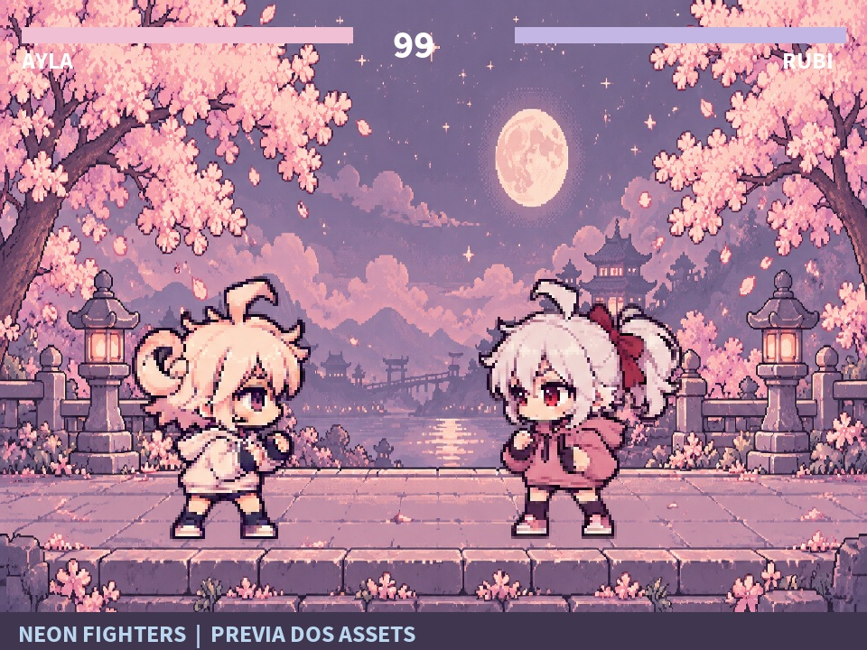

# Neon Fighters

Jogo de luta 2D para Android feito com **IKEMEN GO 1.0.0**, com duas personagens em pixel art chibi pastel e cenário de cerejeiras ao luar.



A imagem acima é uma composição dos assets, não uma captura de partida.

## Baixar e jogar

Baixe **Neon-Fighters.apk** na [página de releases](https://github.com/paulor8bit/neon-fighters/releases/latest). Instale no Android e, na primeira abertura, selecione uma pasta vazia para extrair o jogo, por exemplo `Download/AA`. Aguarde a extração e entre em **ARCADE > SOLO**.

- Direcional: movimento, pulo e agachamento; para trás defende.
- X/Y: socos; A/B: chutes.
- Z/C: atalhos para supers, que exigem energia.

A distribuição usa a engine Android ARM64 oficial. A documentação atual da engine indica Android 13+ e GPU com OpenGL ES 3.2. Compatibilidade com cada aparelho precisa de teste.

## Personagens e arte

**Ayla** segue o modelo fornecido para o projeto: cabelo rosado, chifres enrolados e moletom claro. **Rubi** tem cabelo claro, laço e moletom rosa. Cada personagem usa uma folha com 16 poses, reutilizadas em parte das animações. As duas compartilham a base de movimentos do personagem de exemplo Kung Fu Man.

As artes foram criadas com imagegen, usando a referência em `art/reference/modelo.png`. As especificações estão em [art/PROMPTS-chibi.txt](art/PROMPTS-chibi.txt).

## Estado do projeto

O jogo foi confirmado em execução pelo usuário. A abertura em vídeo foi desativada e a resolução inicial reduzida após um problema de tela preta. Uma segunda falha mantinha as artes antigas na pasta extraída, pois o port Android verifica atualizações pelos scripts. Os arquivos da instalação local foram sincronizados e o processo de preparação agora inclui uma revisão dos assets no script para provocar a atualização.

As verificações locais cobrem assinatura do APK, integridade ZIP, arquivos extraídos e todas as referências de sprites nas animações das duas personagens. Ainda há espaço para refinar colisões, animações e balanceamento.

Se uma instalação mostrar arte antiga, feche o app, selecione uma nova pasta vazia e deixe a versão atual extrair seus arquivos. Preserve seus saves antes de trocar arquivos manualmente.

## Estrutura

- `android/assets/`: personagens SFF/AIR/CNS/CMD, cenários, interface e configuração do jogo.
- `android/res/`, `AndroidManifest.xml` e `apktool.yml`: recursos e identidade do aplicativo.
- `art/`: folhas originais, referência, cenário e prévia.
- `tools/build_apk.py`: monta um APK a partir dos arquivos versionados.
- `tools/build_assets.py` e `tools/finish.py`: integração das folhas e personalização da interface.
- `tools/validate.py`: valida manifesto e referências de animação.

As bibliotecas da engine e os arquivos DEX são obtidos da distribuição oficial durante a compilação; não ficam no histórico Git.

## Compilar o APK

Requisitos: Python 3, JDK 17+, `aapt2`, `apksigner`, acesso à internet no primeiro build e uma chave de assinatura local. Para executar as ferramentas de arte e validação, instale também Pillow (`python -m pip install Pillow`).

```sh
python tools/validate.py
python tools/build_apk.py --keystore /caminho/para/sua-chave.jks --alias minha-chave
```

A ferramenta solicita as senhas da chave sem gravá-las no repositório. `APKTOOL_JAR` pode apontar para uma cópia local do Apktool 3.0.3; `AAPT2` e `APKSIGNER` permitem informar os executáveis. O APK final fica em `releases/Neon-Fighters.apk`.

O build obtém o pacote Android oficial do IKEMEN GO v1.0.0 e verifica seu SHA-256 contra `SHA256SUMS.txt` da mesma release. O bootstrap só extrai as bibliotecas nativas e os DEX necessários; os assets e recursos vêm deste repositório.

As ferramentas de regeneração de arte registram o fluxo usado no ambiente original e podem exigir ajuste do caminho da fonte TrueType em `tools/finish.py`. Compilar os assets já versionados não exige regenerar imagens.

## Créditos e licenças

- [IKEMEN GO](https://github.com/ikemen-engine/Ikemen-GO): engine e distribuição de base, v1.0.0.
- [ikemen-droid](https://github.com/Jesuszilla/ikemen-droid): launcher e controles Android.
- Elecbyte: Kung Fu Man, base de comandos, animações e colisões.
- Motif e assets de terceiros distribuídos com o IKEMEN: créditos e termos originais em [android/assets/LICENSES.txt](android/assets/LICENSES.txt) e nos arquivos `readme`/licenças dos respectivos diretórios.

Os arquivos de terceiros mantêm suas próprias licenças. Este repositório não redefine a licença deles nem concede uma licença geral para todas as artes. A engine usa bibliotecas dinâmicas FFmpeg; o código-fonte correspondente distribuído pelo projeto está disponível na [release oficial v1.0.0](https://github.com/ikemen-engine/Ikemen-GO/releases/tag/v1.0.0), no arquivo `src_ffmpeg.tar.gz`.
